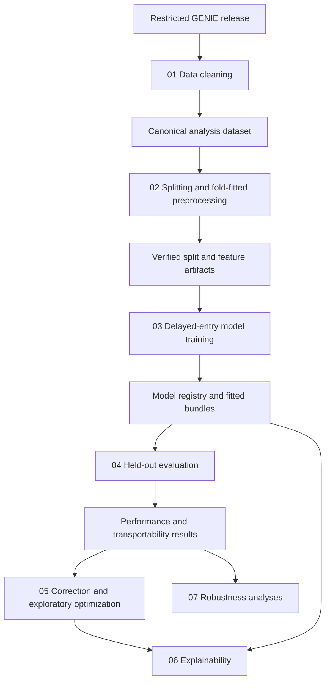

# GENIE BPC CRC FOLFOX transportability study

This repository contains a reproducible, notebook-led survival-analysis study of adults with
metastatic colorectal cancer who received first-line FOLFOX-based therapy. The main question is
whether baseline clinical data can predict overall survival and whether those predictions transport
across DFCI, MSK, and VICC when each institution is held out in turn.

The project is a research analysis, not a clinical prediction product. Its estimates describe
prognosis among patients who received FOLFOX; they do not estimate the causal benefit of FOLFOX over
another treatment and should not be used for individual treatment decisions.

## Study overview

- **Population:** adults with de novo stage IV or recurrent/metachronous metastatic colorectal
  cancer whose first systemic regimen after metastatic presentation was FOLFOX, with or without a
  biologic agent.
- **Primary endpoint:** overall survival (OS) from FOLFOX initiation.
- **Supportive endpoint:** death-inclusive time to next treatment (TTNT-D). This is not treated as a
  validated surrogate for progression or OS.
- **Validation design:** internal-external cross-validation by institution. DFCI, MSK, and VICC are
  each used once as the untouched assessment centre while the other centres form the development
  data.
- **Delayed entry:** genomic sequencing can occur after treatment starts, so all eligible models,
  censoring estimators, survival curves, and performance metrics explicitly use entry, exit, and
  event information.
- **Models:** a transparent four-variable Cox model, a fuller unpenalized Cox model, an elastic-net
  Cox model, and a penalized nonlinear spline Cox model. Small exploratory comparisons also include
  R-based penalized Cox and Royston-Parmar models and a delayed-entry conditional-inference forest.
- **Evaluation:** truncation-aware concordance, time-dependent AUC, Brier score, integrated Brier
  score, calibration slope, calibration-in-the-large, paired bootstrap uncertainty, and
  institution-level transportability comparisons.
- **Interpretation work:** coefficient summaries, grouped partial effects, permutation importance,
  selection stability, prediction stability, cross-centre attribution agreement, robustness
  analyses, subgroup support, and manuscript-ready tables and figures.


## Repository structure

| Location | Purpose |
| --- | --- |
| [`notebooks/`](notebooks/) | Human-readable analysis, in execution order from data cleaning through manuscript assembly. |
| [`src/crc_folfox/`](src/crc_folfox/) | Tested implementation used by the notebooks. This is where cohort rules, transformations, models, metrics, and reporting logic live. |
| [`r/`](r/) | Pinned R environment and adapters for counting-process survival models. R fits and predicts; scoring remains in Python. |
| [`scripts/`](scripts/) | Standalone runners for long or supplementary analyses and figure generation. |
| `analysis/out/archive/` | Optional dated or frozen copies of generated artifacts. This directory is also gitignored. |


Restricted source data and all generated patient-level artifacts are intentionally excluded from
version control.

## How the notebooks use `src/crc_folfox`

The notebooks are intentionally thin orchestration and presentation layers. They configure a run,
call a tested workflow from `src/crc_folfox/`, and display aggregate results. Core calculations are
kept out of notebook cells so the same behavior can be tested without manually executing a
notebook.



| Notebook | What it does | Main Python boundary | Required inputs | Main outputs |
| --- | --- | --- | --- | --- |
| [`01_data_cleaning.ipynb`](notebooks/01_data_cleaning.ipynb) | Audits the release, constructs the FOLFOX cohort, derives predictors and endpoints, and writes the canonical dataset. | `crc_folfox.pipeline.build_clean_analysis_dataset` | `crc_data/` | `analysis_dataset.csv`, data dictionary, cleaning report, run manifest |
| [`02_data_preprocessing.ipynb`](notebooks/02_data_preprocessing.ipynb) | Builds endpoint populations, institution-held-out partitions, repeated pooled partitions, and fold-fitted transformations without leaking assessment data. | `crc_folfox.preprocessing.run_preprocessing_workflow` | Cleaning bundle | preprocessing report and manifest, fold summary, feature schema |
| [`03_model_training.ipynb`](notebooks/03_model_training.ipynb) | Tunes and fits delayed-entry survival models on development data and records every success or failure. | `crc_folfox.model_training.run_model_training_workflow` | Cleaning and preprocessing bundles | fit and tuning summaries, model registry, local model bundles |
| [`04_model_evaluation.ipynb`](notebooks/04_model_evaluation.ipynb) | Loads verified model bundles, predicts on untouched assessment rows, and computes performance and transportability results with paired uncertainty. | `crc_folfox.evaluate.run_evaluation_workflow` | Dataset, preprocessing artifacts, model registry and bundles | performance, calibration, prediction-error, transportability, and complexity-value tables and figures |
| [`05_optimization.ipynb`](notebooks/05_optimization.ipynb) | Corrects the elastic-net failure policy, reconciles the corrected results with the primary analysis, and evaluates a small exploratory candidate set. | `crc_folfox.optimize` | All outputs through model evaluation; R for R-based candidates | correction, reconciliation, exploratory model, and evaluation bundles |
| [`06_explainability.ipynb`](notebooks/06_explainability.ipynb) | Explains one model at a time, persists aggregate intermediate results, and combines completed models into the final explainability bundle. | `crc_folfox.explain.run_model_explainability` and `aggregate_explainability_results` | Primary and corrected model bundles plus exploratory models | coefficients, partial effects, importance, selection and prediction stability, attribution agreement, figures |
| [`07_sensitivity_analyses.ipynb`](notebooks/07_sensitivity_analyses.ipynb) | Tests sequencing lag, delayed-entry assumptions, complete-case subsets, endpoint robustness, calibration drift, local recalibration, and no-information comparisons. | `crc_folfox.sensitivity.run_sensitivity_workflow` | Dataset, preprocessing artifacts, primary model bundles, evaluation results | robustness tables, report, manifest, and figures |


The workflow manifests contain hashes of their inputs and outputs. Downstream steps verify those
hashes before loading results, which prevents an artifact from being silently replaced between
notebooks.

## Requirements

- Python 3.12
- [`uv`](https://docs.astral.sh/uv/) for Python environment management
- R 4.6.1 for analyses that use the R adapters
- JupyterLab
- Access to the GENIE BPC CRC release used by this project
- Enough local storage for generated model bundles and notebook outputs

Python dependencies are declared in `pyproject.toml` and locked in `uv.lock`. They include pandas,
NumPy, SciPy, scikit-learn, lifelines, statsmodels, Matplotlib, seaborn, JupyterLab, and python-docx.
Development dependencies include pytest, Ruff, and Jupytext.

R dependencies are locked in `r/renv.lock`. The adapters use counting-process survival responses
and are called from Python through isolated `Rscript` subprocesses.

## Environment setup

From the repository root:

```bash
uv sync --group dev
```

Restore the R environment if you intend to run model optimization, R-backed explainability, or the
forest comparison:

```bash
cd r
Rscript -e 'renv::restore(prompt = FALSE)'
cd ..
```

Start JupyterLab with the project environment:

```bash
uv run jupyter lab
```

Use the Python kernel associated with this repository's `.venv` environment.

## Restricted data layout

Place the authorized release under `crc_data/` at the repository root. The directory must contain
`manifest.csv` and these nine CSV files:

```text
crc_data/
├── manifest.csv
├── patient_level_dataset.csv
├── cancer_level_dataset_index.csv
├── cancer_level_dataset_non_index.csv
├── regimen_cancer_level_dataset.csv
├── pathology_report_level_dataset.csv
├── imaging_level_dataset.csv
├── med_onc_note_level_dataset.csv
├── tm_level_dataset.csv
└── cancer_panel_test_level_dataset.csv
```

The manifest must provide `name`, `dataFileMD5Hex`, and `dataFileSizeBytes`. The cleaning workflow
checks one-to-one file coverage, hashes, sizes, required columns, data types, duplicates, and linkage
before cohort construction begins. Do not commit the release, the generated dataset, or model
bundles.

Without the restricted release, a reader can review every notebook and run the synthetic test suite,
but cannot reproduce the numerical study results.

## Reproducing the analysis

Run the notebooks in numeric order. They are dependent, not independent: each downstream notebook
verifies and consumes artifacts written by earlier notebooks.

1. Open `notebooks/01_data_cleaning.ipynb` and choose **Restart Kernel and Run All Cells**.
2. Repeat for `notebooks/02_data_preprocessing.ipynb`.
3. Repeat for `notebooks/03_model_training.ipynb`.
4. Repeat for `notebooks/04_model_evaluation.ipynb`.
5. Repeat for `notebooks/05_optimization.ipynb`.
6. Repeat for `notebooks/06_explainability.ipynb`.
7. Repeat for `notebooks/07_sensitivity_analyses.ipynb`.
8. Generate the supplementary forest-comparison and subgroup bundles with the descriptive runners
   in `scripts/` if they are not already present. The long-running forest runner is resumable when
   the same run identifier is reused; consult each runner's module documentation and `--help` output.

Important execution notes:

- Run notebooks from this repository, using the project kernel.
- Do not run dependent notebooks concurrently because they publish to the same canonical output
  tree.
- Keep the default analysis settings for a full reproduction. Reduced inventory and resampling
  arguments are intended only for smoke tests.
- Model fitting and explainability can take many hours. The conditional-inference forest can take
  multiple days.
- The cleaning notebook refreshes `analysis/out/current/`. Set its `CREATE_SNAPSHOT` variable to
  `True` only when a dated archival copy is wanted.
- Patient-level split assignments, transformed assessment matrices, and per-patient predictions are
  not published. Only the canonical cleaned dataset is persisted locally; later public-facing
  artifacts are aggregate.

For command-line notebook execution, the equivalent pattern is:

```bash
uv run jupyter nbconvert \
  --to notebook \
  --execute \
  --inplace \
  --ExecutePreprocessor.timeout=-1 \
  notebooks/01_data_cleaning.ipynb
```

Change the notebook path and execute one notebook at a time in the order above.

## Generated outputs

The main output tree is:

```text
analysis/out/current/
├── analysis_dataset.csv
├── data_dictionary.json
├── cleaning_report.md
├── run_manifest.json
├── preprocessing/
├── model_training/
│   └── models/
├── evaluation/
│   └── figures/
├── explainability/
│   └── figures/
├── sensitivity/
│   └── figures/
├── fairness/
└── manuscript/
```

Additional correction, exploratory-model, and forest-comparison bundles are created beside these
directories. Many tables contain an explicit reporting status:

- `estimable`: the estimate met support and precision requirements;
- `estimable_imprecise`: the estimate is valid but should be interpreted cautiously; and
- `not_computable`: the required fit or information was unavailable.

These categories are part of the result and should not be collapsed or filtered away.

## Source-code map

| Package | Responsibility |
| --- | --- |
| `crc_folfox.data` | Release loading, integrity validation, and aggregate audits |
| `crc_folfox.cohort` | Metastatic CRC, regimen, and FOLFOX cohort construction |
| `crc_folfox.features` | Baseline feature definitions, lookback windows, delayed entry, and feature manifests |
| `crc_folfox.endpoints` | OS and TTNT-D construction and validation |
| `crc_folfox.preprocessing` | Endpoint views, deterministic splits, and fold-fitted transformations |
| `crc_folfox.model_training` | Cox candidate tuning, fitting, bundle serialization, and registry verification |
| `crc_folfox.evaluate` | Delayed-entry prediction, censoring weights, metrics, bootstrap intervals, and transportability comparisons |
| `crc_folfox.optimize` | Elastic-net correction, candidate development, exploratory evaluation, and reconciliation |
| `crc_folfox.explain` | Coefficients, partial effects, grouped importance, and stability comparisons |
| `crc_folfox.sensitivity` | Robustness analyses, recalibration, and no-information comparisons |
| `crc_folfox.forest` | Delayed-entry conditional-inference forest fitting, evaluation, importance, and sensitivity |
| `crc_folfox.report` | Artifact verification, reporting frames, manuscript values, displays, and document assembly |

## Verification

Run the fast test suite, which uses synthetic fixtures and excludes restricted-data tests by
default:

```bash
uv run pytest
```

Run lint checks for the core library and tests, plus the core-library formatting check:

```bash
uv run ruff check src tests
uv run ruff format --check src
```

If the authorized release is available, run the restricted-data checks deliberately:

```bash
CRC_DATA_ROOT=crc_data uv run pytest -m restricted_data
```

The restricted-data checks verify the real cohort and artifact inventories without making the raw
release public.

## Reproducibility and privacy principles

- Random seeds are derived deterministically from endpoint, design, centre, repeat, fold, and
  purpose.
- Preprocessing is fitted on development rows only and recreated inside every validation split.
- Assessment-centre outcomes never influence model fitting or tuning.
- Model bundles and analysis artifacts are hash-verified before reuse.
- R is limited to fitting and prediction; Python owns selection rules, scoring, comparisons, and
  reporting.
- Failed fits, low-support estimates, and unfavorable comparisons remain visible in the output.
- Restricted identifiers and patient-level predictions are not published.
- Generated restricted-data artifacts stay under gitignored directories.

## Code availability and citation

The analysis code and executed Jupyter notebooks supporting this study are available in this
public repository, **GENIE BPC CRC FOLFOX transportability study**. The numbered notebooks retain
their executed outputs. Restricted patient-level data and patient-level derived artifacts are not
included; access to the source data remains governed by the applicable data-use agreement.

The manuscript-associated version is released as
[`v0.1.0`](https://github.com/CamilaSarmiento52/genie-crc-folfox-survival-transportability/releases/tag/v0.1.0)
and archived in Zenodo at
[`https://doi.org/10.5281/zenodo.22075298`](https://doi.org/10.5281/zenodo.22075298).
Cite this version-specific Zenodo record when referring to the exact code used for the study.
Citation metadata are provided in [`CITATION.cff`](CITATION.cff).
